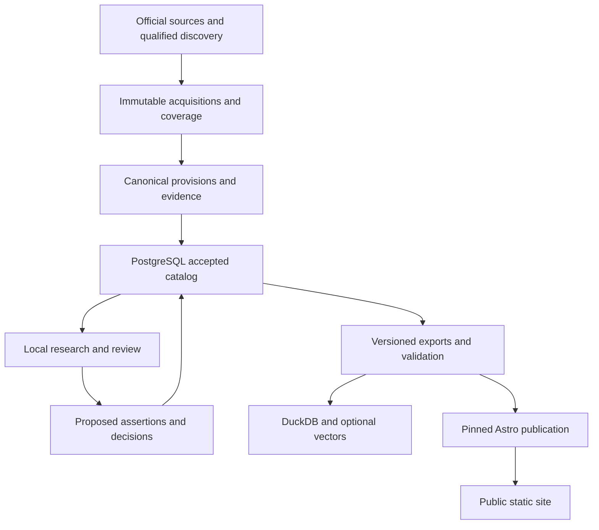

# Architecture

**Proposed target; preserve the current application while adding these capabilities.**

## 1. Two delivery surfaces

Run acquisition, normalization, review, graph queries, and optional model processing on the local Linux workbench. Publish a complete static Astro bundle to the existing hosting destination. The deployment should contain public text, evidence, data downloads, indexes, and coverage manifests; it must not depend on private services to render them.

This shows data and review flow. It is not the processing DAG: the editorial feedback loop creates new immutable revisions rather than a cyclic execution dependency.

## 2. Authority and reconstruction

Use one accepted catalog in PostgreSQL. It owns the stable identity registry, accepted legal/evidence records, review history, current task generations, and publication selections. Raw source bytes, canonical JSONL, and generated outputs live in a content-addressed local artifact store. Large raw corpora need not enter ordinary Git.

Neither a loose file nor an unaccepted worker output becomes current merely because it exists. A transaction selects accepted immutable inputs and outputs. Each accepted release exports its schema version, identity registry changes, review/acceptance records, coverage, and manifest. Those records, source artifacts, and database backups must allow reconstruction without guessing stable identities or editorial decisions. Maintain one explicit restore/replay procedure, not two independently writable representations of truth.

DuckDB reads pinned Parquet/JSONL for analysis; it does not mutate accepted records. Optional pgvector indexes selected text versions and evidence. Both are disposable projections with recorded producer/configuration identities. A file-only fixture path implements the same reader contracts for tests and contributor builds; it is not an alternative production catalog.

## 3. Repository boundaries

| Repository | Retained responsibility | Planned additions |
| --- | --- | --- |
| `us-code-tracker` | TypeScript ingestion/transformer, shared schemas, orchestration, Astro UI | Domain contracts, accepted-catalog adapter, evidence review, incremental planning, publication validation |
| `us-code` | Versioned public data and existing history | Compact accepted manifests, compatibility exports, immutable links to larger artifacts if needed |
| `cap-citation-pipeline` | Existing Python citation producer | Contract-compatible adapter and parity fixtures; retire duplicate production responsibility only after review |

Do not create a shared platform repository before a concrete second consumer exists. HCK remains separate and optional. Preserve current repository instructions, package manager, release conventions, and useful tests.

## 4. Module seams

Prefer substantial modules with small public interfaces over many thin wrappers. The initial conceptual seams are:

| Module | Public responsibility |
| --- | --- |
| Source acquisition | Enumerate a bounded scope, fetch immutable artifacts, emit acquisitions and explicit coverage |
| Canonicalization | Preserve legal structure, produce provision versions, and map output spans to source spans |
| Identity resolution | Assign stable IDs, resolve citations by context, retain ambiguity and evidenced transitions |
| Evidence and review | Store typed assertions, source support, conflicts, decisions, and supersession |
| Accepted catalog | Transactionally accept validated records and expose versioned query contracts |
| Dependency planning | Determine affected work from inputs, collections, policies, and producer versions |
| Execution | Run a logical task, retain attempt receipts, validate, and propose acceptance |
| Publication | Export a complete candidate, validate it, build it, promote it, and verify its deployed identity |

These are design responsibilities, not instructions to create eight services. Keep source-specific parsing behind acquisition/canonicalization interfaces. Keep database access behind catalog contracts. External AI responses and network clients are boundaries appropriate for test doubles; avoid mocking internal implementation calls.

## 5. Acquisition and fidelity

An acquisition captures exact bytes, original/final URL, publisher identifiers, actual retrieval time, format, checksum, and relevant observed headers. Discovering a URL in a third-party project does not make that project the publisher. Classify sources by official status, document type, currency, redistribution, authentication, and supported collection methods.

Store the source release label losslessly, including exclusions and corrections. Separate a publisher's label from immutable content identity. A stable URL changing bytes creates a new snapshot. A network failure or incomplete collection cannot create a successful empty release.

Normalize into structured provisions, retaining ordered children, mixed text, tables, notes, source credits, and source spans. Render Markdown/HTML from that model. Unsupported structures retain a faithful fallback and an explicit fidelity issue. Record exclusions for navigation and other nonlegal material with locators and reasons.

Validate byte integrity, structural validity, enumeration completeness, semantic fidelity, cross-reference integrity, and publication consistency separately. A perfect checksum for an empty extraction is still a failed legal-data product.

## 6. Time and identity

Provision IDs are stable registry entries. Citations, current chapter paths, and USLM source identifiers are retained as qualified crosswalks. A later backfill cannot silently renumber the registry. Citation reuse, transfers, splits, and mergers require evidence and support ambiguity.

Keep source publication, actual observation, legal effect, and conditional applicability separate. Store dates at their known precision; do not use an approximate Congress year as an effective date. Applicability may attach to a subsection or assertion. No section-wide date should erase different clauses' conditions.

An as-published route resolves snapshot membership. A known-as-of query filters actual recorded observations. A legally-applicable query requires the relevant facts and can return conditional, disputed, or unknown. Build as-published fidelity first; do not promise comprehensive effective-date reasoning when notes have not been reviewed.

## 7. Legal graph and processing graph

The legal graph contains provisions, source documents, citations, assertions, evidence, and decisions. Begin with precise edges such as cites, authority-citation, amends, transfers, and supersedes. Stronger claims such as judicial treatment require their own contract and review. A regulation's part-level authority list does not prove subsection-level implementation.

The processing graph contains input and output artifacts plus producers. Its task identity includes immutable input hashes, relevant producer/toolchain versions, schema/normalization/resolver versions, configuration, and policy decisions. Keep retrieval timestamps and attempt IDs out of semantic identities when they do not affect output.

Record direct dependencies, collection versions, and negative dependencies. A case search that found nothing depends on the searched corpus and coverage. A new missing citation target must invalidate the prior unresolved result. Reverse indexes are derived outputs, rebuilt deterministically and validated; malformed source records cannot simply disappear from them.

A source update triggers affected deterministic products; a producer update can trigger recomputation without implying a legal amendment. Compare incremental and clean builds on the same frozen inputs. Until correctness is demonstrated, fully rebuild a bounded search index rather than implement a fragile partial updater.

## 8. Execution and optional HCK

Start with one process executing finite tasks. A task can have multiple attempts; acceptance is idempotent. On worker expansion, add leases with monotonically increasing fencing tokens and compare-and-swap acceptance. Workers write immutable outputs before proposing them; stale workers cannot replace accepted newer results.

The HCK boundary is an immutable task specification and an artifact receipt: input digests, pinned environment digest, resource requirements, output declarations, validation receipts, and attempt identity. HCK can execute work; Tracker still owns legal schemas and accepted results. HCK's runtime job state does not become another legal database.

Separate environment composition, artifact distribution, runtime preparation, and accepted result caching. Verify the actual ACQ/kit interface before writing an adapter; do not invent command-line options from a design sketch. Use an existing external scheduler only when measured work justifies it. Do not make Temporal, Slurm, HyperQueue, or cloud infrastructure mandatory for a single local host.

## 9. Local discovery and models

Start with exact lookup and PostgreSQL full-text search. Its built-in ranking is not BM25; choose any additional ranking extension only after verification and evaluation. Add optional embeddings using a pinned dedicated embedding model, dimensions, chunking, and index configuration. Filter by jurisdiction, access, source release, version, and review state before giving evidence to a model, then validate retrieved identifiers.

Use the configured local Gemma endpoint through a provider interface. Model services propose summaries, citation candidates, or review hints; they cannot create verified legal facts by themselves. Persist the model identity, available weights/runtime digest, prompt, configuration, exact inputs, output hash, and review disposition. Accepted model artifacts can be replayed without assuming stochastic reruns produce identical bytes.

Maintain a frozen evaluation set with known relevant sources, wrong-version traps, unsupported-claim checks, and abstention cases. Ship optional model assistance only when it improves the declared task over lexical retrieval and stays within measured host limits. Models are disabled in the mandatory core build.

## 10. Static publication

The publication manifest selects accepted source and graph versions, public exports, licenses, validation receipts, toolchain identity, and predecessor release. Build pages, timelines, diffs, search indexes, and coverage from that one selection. Existing data submodule delivery can remain initially; explicitly update its exact pin to the accepted data commit before deployment.

Current browsing may use Pagefind. Historical search must retain a named scope, with bounded release/title shards rather than one unbounded browser download. Deep links contain enough identity to resolve the intended historical object. Evidence panels show source links, excerpts, status, and relevant dates in plain language.

Validate a complete candidate, upload versioned assets, promote the deployment through the hosting platform's supported release mechanism, and verify its manifest. Preserve the preceding complete deployment for rollback. If the platform cannot provide a separate pointer switch, use its complete-deployment mechanism and test failure behavior; never assume per-file uploads are atomic.

No private review notes, credentials, internal service URLs, raw job environments, or model endpoints enter public exports. Optional live links can open source sites, but the published legal evidence itself is pinned.
